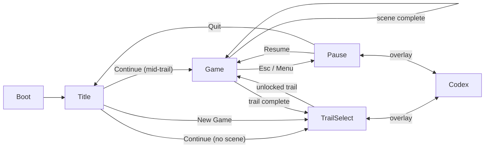

# Architecture

## The idea in one paragraph

All the rules of the game (what unlocks when, what gets saved, how a conversation moves) live
in small **pure JavaScript modules** that know nothing about Phaser or the browser. The Phaser
scenes are a thin layer that draws things and forwards input. This is why 61 unit tests can
check the SRS rules in under a second, and why the browser tests only need to check the
glue.

## Layers

```
 data/*.json  ──►  content/        systems/ (pure logic)        scenes/ + ui/ (Phaser)
 story as data     load + validate  storage  saveManager         Boot Title TrailSelect
                                    unlocks  dialogue            Game Pause Codex
                                    settings device              DialogueUI TouchControls
                                          ▲                             │
                                          └────────  session.js  ◄──────┘
                                              (current save + SaveManager)
```

Dependencies only point downward: scenes may import systems, systems never import scenes.
`config.js` is imported by everyone; it is the single place for numbers taken from the SRS.

## Scene flow



`Pause` and `Codex` are **overlays**: they are launched on top of the scene that opened them,
which is paused until the overlay closes.

## How a story scene runs

1. `GameScene` loads one story scene (a room with an NPC, from the trail JSON).
2. The player walks to the NPC. Inside `INTERACT_RANGE` a prompt appears.
3. Interacting calls `DialogueRunner.startScene()`. The runner returns **steps**:
   `{kind: 'node', node, unlocks}` or `{kind: 'sceneEnd', nextSceneId, trailComplete}`.
4. `DialogueUI` draws the node. Lines and context panels call `advance()`; decisions call
   `choose(optionId)`, which returns the chosen outcome text plus the next step.
5. Every step's `unlocks` go through `unlockCodexEntries()`; new entries show a toast.
6. On `sceneEnd`: the save is updated, written (a save point), and the scene restarts on the
   next story scene, or the trail-complete message is shown.

The runner never touches the screen. That is what lets `simulateRun()` play a whole trail
automatically, which is how the validator proves "always choosing the first option and always
choosing the last option both reach the final scene" (FR 3.4).

## State and saving

`session.js` holds the current save object and the `SaveManager`. Scenes change the save only
through the pure functions in `unlocks.js` (they return a new object, never mutate) and write
it with `persist()` at save points. Details and failure handling: [SAVE-DATA.md](SAVE-DATA.md).

## UI sizing (why buttons look bigger on a phone)

The canvas is 960x540 "game pixels" scaled to fit the screen. NFR 3 requires touch targets of
48 **CSS** pixels, so `ui/button.js` converts: `minTarget = ceil(48 / (displayed width / 960))`.
On a small phone the same button needs more game pixels. Never hard-code a button smaller than
`minTarget(scene)`; use `makeButton()`, which enforces it. The same conversion is used for the
8 px gap between targets. Text uses `fontPx()`, which applies the player's text-size setting.

The scale is read when a scene is created. Rotating the device or resizing the window does
not re-layout the current scene (see roadmap).

## Design decisions worth knowing

- **Story is data, not code.** A new trail is a JSON file. See [CONTENT-SCHEMA.md](CONTENT-SCHEMA.md).
- **One write path.** Only `SaveManager.write()` touches storage, and only after a verified read-back.
- **Nothing is trusted from storage.** Loaded data is validated; bad data becomes a status
  (`corrupt`, `incompatible`), never an exception.
- **No network calls.** The game sends nothing anywhere (NFR 1). Pilot data comes from surveys.
- **Placeholder graphics.** Everything is drawn with rectangles so gameplay can be built and
  tested before art exists. Replace shapes with sprites inside `GameScene.create()`.
- **Dev hooks.** In `npm run dev` the game is on `window.__game` and the session on
  `window.__session`. They are removed from production builds.

See also: [adr/0001-tech-stack.md](adr/0001-tech-stack.md), [adr/0002-local-save-strategy.md](adr/0002-local-save-strategy.md).
